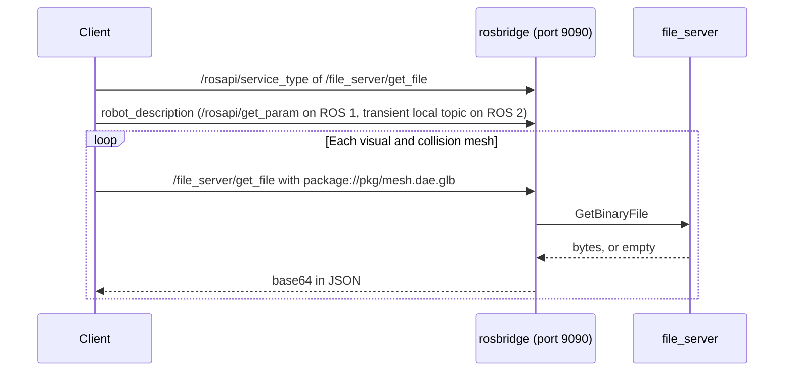

# Robot Models

OpenRoSDE serves the model of the robot to any client of `rosbridge`, so that a web or Unity application can draw the robot it connects to without bundling its meshes.
A client reads the robot description, then fetches each mesh it names through a file service, as a GLB that loads the same way in three.js, Unity, and most other engines.
Coarobo Viewport and Coarobo Sightline load robot models this way.



The client first checks that the file service exists, then reads the robot description, then fetches each mesh through `rosbridge`, which answers with the bytes of the file in base64.

## 🗂️ File Service

`rosbridge_server_default.launch` of `openrosde_launch` starts `rosbridge` on port `9090` and, beside it, the node `file_server` of [ROS#](https://github.com/siemens/ros-sharp) `2.3.1` (Apache 2.0), which the base image builds from source with the patches of `docker/openrosde-base/patches/ros-sharp/`.
On ROS 2, `rosbridge_server_default.launch.xml` of `openrosde_launch` in `ros2/openrosde_colcon_ws/` starts both the same way, from the package `file_server2` of ROS#, which the base image of ROS 2 builds with the same three patches adapted in `docker/openrosde-base-ros2/patches/ros-sharp/`, as [ROS 2](ros2.md) describes.

| Item                 | Value                                                                                                                                                                                 |
| -------------------- | ------------------------------------------------------------------------------------------------------------------------------------------------------------------------------------- |
| Service              | `/file_server/get_file`                                                                                                                                                               |
| Type                 | `file_server/GetBinaryFile` on ROS 1, `file_server2/srv/GetBinaryFile` on ROS 2                                                                                                       |
| Request              | `string name`, a `package://` address                                                                                                                                                 |
| Response             | `uint8[] value`, sent by `rosbridge` as base64 in JSON                                                                                                                                |
| Files served         | Meshes (`.dae`, `.stl`, `.obj`, `.mtl`, `.glb`) and textures (`.png`, `.jpg`, `.jpeg`, `.bmp`, `.tga`, `.tif`, `.tiff`, `.gif`) only                                                  |
| Size limit           | `max_file_size`, 12,000,000 bytes, so that no response exceeds 16 MiB of JSON after base64                                                                                            |
| Saving and `file://` | Off (`allow_save` and `allow_file_url` are `false`)                                                                                                                                   |
| `robot_description`  | A parameter read through `/rosapi/get_param` on ROS 1, the transient local topic of `robot_state_publisher`, of type `std_msgs/msg/String`, on ROS 2                                  |
| `rosbridge` on ROS 2 | `max_message_size` set to `100000000` and `call_services_in_new_thread` to `true`, explicitly, so that no response comes in fragments and a large file never stalls the other traffic |

- A file that does not exist, is not a mesh or a texture, leaves its package, or exceeds `max_file_size` is answered with `result: true` and an empty value, so the client falls back for that mesh alone.
- No file service at all shows as an empty answer of `/rosapi/service_type`, or as `result: false` from `rosbridge`, so the client falls back to its own model.
- `rosbridge` calls every service in a thread of its own, so a large file never stalls the other traffic of a connection, and the core never splits a response into fragments.
- The patches serve `.glb`, narrow the files served to meshes and textures, add `max_file_size`, and install the node, so that it runs from `/opt/ros/noetic` like a package of the distribution.
- On ROS 2, the third patch also links the node with the targets of its dependencies, since Lyrical removed `ament_target_dependencies`, and leaves out the examples of ROS#, so that the node and its interfaces install into `/opt/ros/lyrical`.
- The file service of ROS 2 refuses a file whose real path leaves the share folder of its package, so the colcon workspaces build without `--symlink-install`.

## 🧊 GLB Files

The GLB of a mesh sits beside it, named by appending `.glb` to its full file name in its original case, such as `meshes/base.dae.glb` beside `meshes/base.dae`, since some packages ship the same name as `.dae` and `.stl` with different geometry.

- A GLB holds the mesh as RViz places it in the frame of the URDF `<visual>` or `<collision>`, turned from the Z-up axes of ROS into the Y-up axes of glTF, `glTF (x, y, z) = ROS (x, z, -y)`.
- The COLLADA unit and node transforms are kept as node matrices, and the COLLADA `up_axis` is ignored, as RViz does.
- The URDF `<origin>` and `<mesh scale>` are not applied, so a client places a GLB at `T(origin) * S(scale) * R_x(+90 deg)`, as `three.js` does with `rotateX(Math.PI / 2)` inside the scaled mesh.
- An STL becomes bare positions with no normals and no material, so the client draws flat normals and the URDF `<material>`.
- COLLADA and MTL colors become linear `baseColorFactor` values, with their textures embedded.
- Every GLB is one glTF 2.0 binary scene with no required extension, and names in its `asset` the converter, a copyright line, and in `extras` the package, the source address, the license, and the SHA-256 of the source.

:::important

GLB files are generated on each machine and never committed or published, since the meshes of some robots carry licenses that forbid redistribution or derivatives.
Check the license of every description package before you ship its meshes or their GLBs to anyone.

:::

## 🔄 Generating GLB Files

The converter is the image `openrosde-mesh2glb`, which the CI publishes beside the base image, with [`trimesh`](https://github.com/mikedh/trimesh) (MIT) and [`pycollada`](https://github.com/pycollada/pycollada) (BSD) pinned so that the same mesh gives the same bytes.
It runs apart from the ROS images, since it needs a newer Python than Ubuntu 20.04 has.

- The meshes installed in the images, under `/opt/ros/<distribution>/share`, get their GLBs when `BUILD-DOCKER-IMAGE.bash` builds the user overlay, in a stage of `docker/user-devel/Dockerfile`.
- The meshes of the Catkin and colcon workspaces of the core and of the extensions get theirs from `scripts/generate-mesh-glbs.bash`, which `BUILD-DOCKER-IMAGE.bash` runs once the images are ready.
- A colcon workspace serves the copy of a mesh in its install space, so on ROS 2 build the workspaces again after the script, with `openrosde-build-catkin-workspaces`, to install the new GLBs.

Run the script again after editing or adding a mesh in a workspace:

```bash
bash ./scripts/generate-mesh-glbs.bash
```

It converts only the meshes whose GLB is missing, older than the mesh, or written by another version of the converter, and it adds the patterns of the GLBs to `info/exclude` of every repository it writes into, so no GLB shows as a change.
A mesh that cannot be converted is reported and skipped, and clients then fall back to the original mesh or to the collision mesh of its link.

## ✅ Checks in the CI

- `check-mesh-glbs-job` converts the meshes of the base image and of the workspaces twice, fails unless both runs give the same bytes, and checks every GLB with the [Khronos glTF-Validator](https://github.com/KhronosGroup/glTF-Validator).
- Every test job of a setup gives the meshes of its container their GLBs with `gitlab-ci/generate-ci-mesh-glbs.bash`, before its workspaces build, then `gitlab-ci/check-robot-model.bash` starts `rosbridge_server_default.launch`, or `rosbridge_server_default.launch.xml` on ROS 2, with the network cut and checks the file service through `rosbridge` the way a client calls it.
- That check fetches every GLB of the workspaces and up to 20 of each installed package with its mesh, byte for byte, fails when a GLB of a workspace exceeds `max_file_size`, checks what the service refuses, and checks that a client sees the service gone once it stops.
- A GLB above `max_file_size` whose mesh lies in a Git submodule, third-party code that a platform pins and cannot simplify, such as `waffle_base.stl` of the TurtleBot3, is reported rather than failed, since clients fall back to the collision mesh of its link.
- `robot-model-fragments-job` runs the same check on the core alone on ROS 2 through a `rosbridge` with `max_message_size:=1000000`, as a stock `rosbridge` may split messages, with GLBs of 3,000,000, 11,990,000, and 12,000,001 bytes added, and checks that a client reassembles the `fragment` messages by `id`, `num`, and `total` into the same bytes.
- The pipeline of an extension that runs before the core publishes the converter skips the robot model with a warning.
