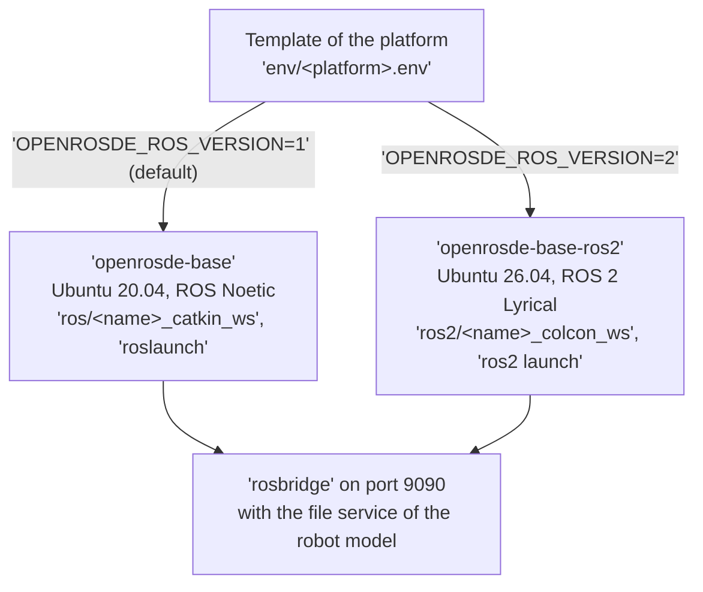

# ROS 2

OpenRoSDE runs ROS 1 and ROS 2 side by side, and never drops ROS 1, since robots such as the Fetch run only on ROS 1.
Each platform declares the ROS it runs in its template, and everything else follows from that choice: the base image, the workspaces, the launch tool, the `tmux` panes of the core, the network settings, and the jobs of the CI.
Clients such as Coarobo Viewport and Coarobo Sightline reach either ROS through `rosbridge` on port `9090`, so no bridge between ROS 1 and ROS 2 is needed.



The template of the platform selects the base image, the workspaces, and the launch tool, and both versions of ROS meet again at `rosbridge` on port `9090`.

## 🧭 Choosing the ROS of a Platform

A platform runs ROS 1 unless its template sets the two lines that `env/openrosde-ros2.env` of the core holds:

```shell
OPENROSDE_ROS_VERSION=2
OPENROSDE_ROS_DISTRO=lyrical
```

| Item                   | ROS 1                                                                            | ROS 2                                                                                       |
| ---------------------- | -------------------------------------------------------------------------------- | ------------------------------------------------------------------------------------------- |
| Settings               | `OPENROSDE_ROS_VERSION=1`, `OPENROSDE_ROS_DISTRO=noetic`, the defaults of `.env` | `OPENROSDE_ROS_VERSION=2`, `OPENROSDE_ROS_DISTRO=lyrical`, set by the template              |
| Base image             | `openrosde-base`: Ubuntu 20.04, ROS Noetic, CUDA 11.2, Gazebo Classic            | `openrosde-base-ros2`: Ubuntu 26.04, ROS 2 Lyrical Luth, Gazebo Jetty through `ros_gz`      |
| Workspaces             | `ros/<name>_catkin_ws`, built with `catkin build`                                | `ros2/<name>_colcon_ws`, built with `colcon build`                                          |
| Workspaces of the core | `ros/openrosde_catkin_ws` and `ros/user_catkin_ws`                               | `ros2/openrosde_colcon_ws` and `ros2/user_colcon_ws`                                        |
| Launch files           | `roslaunch`, `.launch`                                                           | `ros2 launch`, `.launch.xml` or `.launch.py`                                                |
| Panes of the core      | `tmux/openrosde.panes`                                                           | `tmux/openrosde-ros2.panes`                                                                 |
| Network                | A ROS master, at `OPENROSDE_ROS_MASTER_HOSTNAME`                                 | No master: the domain `OPENROSDE_ROS_DOMAIN_ID` and the discovery of ROS 2                  |
| Robot model            | `robot_description` as a parameter, `file_server/GetBinaryFile`                  | `robot_description` as a transient local topic, `file_server2/srv/GetBinaryFile`            |
| FlexBE                 | Behavior engine and FlexBE App                                                   | Behavior engine and FlexBE WebUI, built from its submodule, which supersedes the FlexBE App |
| Terminator             | Layouts of the platform, until `tmux` replaces them                              | None, `RUN-TMUX-SESSION.bash` only                                                          |

Both base images share the helper scripts of `docker/openrosde-base/scripts/`, which read the ROS of the platform from the settings, so the shell functions keep their names on ROS 2, such as `openrosde-build-catkin-workspaces`, which builds the colcon workspaces there.
`scripts/load-extension-paths.bash` derives `OPENROSDE_BASE_IMAGE_NAME`, `OPENROSDE_ROS_WORKSPACE_FOLDER`, and `OPENROSDE_ROS_WORKSPACE_SUFFIX` from `OPENROSDE_ROS_VERSION`, and the entry scripts stop on any version other than `1` or `2`.

## ➕ Adding a Platform on ROS 2

A platform on ROS 2 takes the layout of any platform, as the [Extensions](extensions.md) guide describes, with these differences:

1. Its template `env/<platform>.env` sets `OPENROSDE_ROS_VERSION=2` and `OPENROSDE_ROS_DISTRO=lyrical`, and may set `OPENROSDE_ROS_DOMAIN_ID`.
2. Its `docker/<platform>-devel/Dockerfile` builds on `ARG OPENROSDE_BASE_IMAGE=ghcr.io/openrosde/openrosde-base-ros2:main`, which the build and the CI replace with the base image of ROS 2.
3. Its packages live in colcon workspaces, `ros2/<name>_colcon_ws/src/`, with the sources that no distribution releases as Git submodules pinned by commit, and patches for Lyrical in `patches/ros2/<name>_colcon_ws/src/<submodule>/`.
4. Its panes in `tmux/<platform>.panes` name launch files of ROS 2, such as `turtlebot3_bringup_default_gazebo.launch.py`, in its launch package.
5. A platform whose name holds a dash, such as `turtlebot3-ros2`, names its launch package in `scripts/<platform>/initialize-bash-shell.bash`, with `OPENROSDE_LAUNCH_PACKAGE=openrosde_turtlebot3_launch`, since no ROS package may take the name `openrosde_turtlebot3-ros2_launch` that the core derives.

One repository may hold the same robot on both ROS as two platforms, as `openrosde-platform-turtlebot3` holds `turtlebot3` on ROS 1 and `turtlebot3-ros2` on ROS 2.
The loader then takes the workspaces, the Docker Compose overlay, and the panes of the active platform alone, since a file named after the other platform is left out.

## 🔌 Network on ROS 2

ROS 2 has no master, so the shell of the container sets the domain and the discovery instead:

- `local_mode` keeps the discovery on this machine, with `ROS_AUTOMATIC_DISCOVERY_RANGE=LOCALHOST`, the default when `OPENROSDE_ROS_MASTER_HOSTNAME` is `localhost`.
- `remote_mode` extends it to the local network, with `ROS_AUTOMATIC_DISCOVERY_RANGE=SUBNET` and the robot as a static peer in `ROS_STATIC_PEERS`, from `OPENROSDE_ROS_MASTER_HOSTNAME`.
- `ROS_DOMAIN_ID` comes from `OPENROSDE_ROS_DOMAIN_ID`, `0` by default, which the robot must share.

:::important

The nodes of the robot must run the same middleware as the container, Fast DDS by default, in the same domain, and a ROS 2 distribution whose messages match those of Lyrical.

:::

## 🧱 Colcon Workspaces

- `openrosde-reset-catkin-workspaces` updates `rosdep` for Lyrical, removes the `build/`, `install/`, and `log/` spaces of every colcon workspace, then builds them all in order, and `openrosde-build-catkin-workspaces` builds them again.
- `colcon build` runs without `--symlink-install`, since the file service of the robot model refuses a file whose real path leaves the share folder of its package, which a symbolic link into `src/` does.
- A colcon workspace serves its meshes from its install space, so build it again after `bash ./scripts/generate-mesh-glbs.bash` adds a GLB, as [Robot Models](robot-models.md) describes.
- `OPENROSDE_BUILD_JOBS` caps the packages that `colcon build` builds at once, and the jobs of `make` while the load stays below it.

## ✅ Checks in the CI

- `build-base-ros2-image-job` builds or reuses `openrosde-base-ros2`, whose sources are `docker/openrosde-base-ros2/` and the shared scripts of `docker/openrosde-base/scripts/`, and the image of a platform on ROS 2 builds on it.
- `test-core-ros2-workspaces-job` tests the core alone on ROS 2, with the settings of `env/openrosde-ros2.env`, and `robot-model-fragments-job` tests it again through a `rosbridge` that splits every message above 1,000,000 bytes into `fragment` messages, which the check reassembles byte for byte.
- `gitlab-ci/check-launch-files.bash` loads every launch entry point of the panes with `ros2 launch --show-args`, which starts no node, while the node names of two panes are not compared, since ROS 2 cannot list them without starting the nodes.
- `gitlab-ci/check-no-motion.bash` also fails on any `ros2 launch` beyond `--show-args`, `--show-arguments`, `-s`, `--print`, `--print-description`, or `-p`, and on any `ros2 run`, `ros2 topic pub`, `ros2 service call`, `ros2 action send_goal`, `ros2 bag play`, or `ros2 lifecycle set`, apart from the simulations that an allowlist names.

## 📌 Pinned Versions

| Component           | Version                                                                                                                                   | Where                                   |
| ------------------- | ----------------------------------------------------------------------------------------------------------------------------------------- | --------------------------------------- |
| Base of the image   | `ros:lyrical-ros-base`, pinned by the digest of its index of architectures                                                                | `docker/openrosde-base-ros2/Dockerfile` |
| Gazebo              | Gazebo Jetty (`gz-sim` 10), through the vendor packages of the distribution that `ros_gz` 3 depends on, as REP 2000 pairs it with Lyrical | The packages of the image               |
| `rosbridge_suite`   | `4.2.1` from the distribution on 2026-10-15                                                                                               | The packages of the image               |
| ROS# `file_server2` | `2.3.1`, commit `9e2644e1b201605417308e8d1a67cdd6b012b31c`, with the patches of `docker/openrosde-base-ros2/patches/ros-sharp/`           | `docker/openrosde-base-ros2/Dockerfile` |

## ⚠️ Known Limits

- No FlexBE App is released for ROS 2 Lyrical, so ROS 2 takes the [FlexBE WebUI](https://github.com/FlexBE/flexbe_webui), its successor, built from the submodule `ros2/openrosde_colcon_ws/src/flexbe_webui` with the dependencies that the image installs, and started by the first pane of the window `tools` with `openrosde_launch:flexbe_webui_default.launch.xml`.
- The WebUI opens in a desktop window, or, with `headless:=true`, in any browser at `http://127.0.0.1:8000`, whose address and port the arguments `host` and `port` change.
- The platforms on ROS 2 have no Terminator layout, and `RUN-TERMINATOR-TERMINAL.bash` points to `RUN-TMUX-SESSION.bash` for them.
- The first platform on ROS 2 is `turtlebot3-ros2` of `openrosde-platform-turtlebot3`, while the other canonical platforms run on ROS 1.
