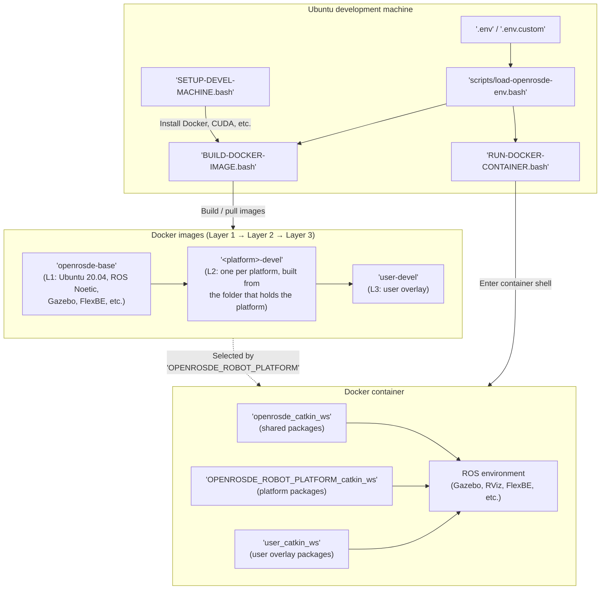

# Introduction

OpenRoSDE, read "Open Robotic SDE", is the open-source reference implementation of the Software Development Environment (SDE) described in "**Software Development Environment for Collaborative Research Workflow in Robotic System Integration**" (DOI: [10.1080/01691864.2022.2068353](https://doi.org/10.1080/01691864.2022.2068353)).
It is maintained by [Coarobo GK](https://coarobo.com/) and developed in the open at [https://github.com/openrosde/openrosde](https://github.com/openrosde/openrosde).

The whole OpenRoSDE is containerized with [Docker](https://www.docker.com/).
This ensures that all the contributors work in the exact same software environment.
Its robot, simulator, visualization, and behavior interfaces are primarily implemented with [ROS](https://www.ros.org/), [Gazebo](http://gazebosim.org/), [RViz](https://github.com/ros-visualization/rviz), and [FlexBE](http://flexbe.github.io/).

## 🔍 Overview

The scripts of the Ubuntu development machine build or pull a stack of Docker images, and the platform that `OPENROSDE_ROBOT_PLATFORM` selects decides which image the container runs.
The Docker image stack has three layers:

- **Layer 1** (`openrosde-base`) provides the shared ROS, Gazebo, and FlexBE toolchain.
- **Layer 2** (`<platform>-devel`) adds the robot-specific packages selected by `OPENROSDE_ROBOT_PLATFORM`, from the repository of the platform cloned into `extensions/`.
- **Layer 3** (`user-devel`) is the [user overlay](guides/user-overlay.md), where you add your own packages and customizations without touching the platform images.

A platform on ROS 2 builds on the Layer 1 image `openrosde-base-ros2` instead, Ubuntu 26.04 with ROS 2 Lyrical, with the colcon workspaces of `ros2/`, as the [ROS 2](guides/ros2.md) guide describes.
Extensions cloned into `extensions/` can add their own layers between Layers 2 and 3, as the [Extensions](guides/extensions.md) guide explains.

## 🤖 Supported Robot Platforms

Each canonical platform lives in a repository of its own, which OpenRoSDE finds by name once it is cloned into `extensions/`.
Every platform runs ROS 1 Noetic, apart from `turtlebot3-ros2`, which runs ROS 2 Lyrical beside it.
[Platforms & Devices](platforms.md) lists the robots and the devices with their repositories.

## 🧭 Where to Go Next

- **Try it:** the [Quick Start](getting-started/quick-start.md) sets up an Ubuntu development machine and opens a first session on a robot platform.
- **Set it up in detail:** the [Basic Usage](getting-started/basic-usage.md) guide covers the prerequisites, the installation, the build, and the run.
- **Customize it:** add your own packages with the [User Overlay](guides/user-overlay.md), or a platform or a device with [Extensions](guides/extensions.md).
- **Contribute:** read [Contributing](project/contributing.md), which also describes how to add support for a new robot platform.
- **Cite it:** use the references of [Citing OpenRoSDE](project/citing.md) if OpenRoSDE supports your research.

## 🕰️ History

OpenRoSDE was first published as the Software Development Environment (SDE) of Coarobo GK under the MIT License, which still covers the versions before 3.0.0.
The archive of those versions remains at [https://gitlab.com/coarobo/SDE](https://gitlab.com/coarobo/SDE).
OpenRoSDE is now developed on GitHub under the Apache License 2.0, as [License](project/license.md) describes.
Version 3.0.0, released on 2026-10-16, is the first release on GitHub, and its notes and the changelog of the core list what changed:

- Release notes: [https://github.com/openrosde/openrosde/releases/tag/v3.0.0](https://github.com/openrosde/openrosde/releases/tag/v3.0.0)
- Changelog: [https://github.com/openrosde/openrosde/blob/main/CHANGELOG.md](https://github.com/openrosde/openrosde/blob/main/CHANGELOG.md)
